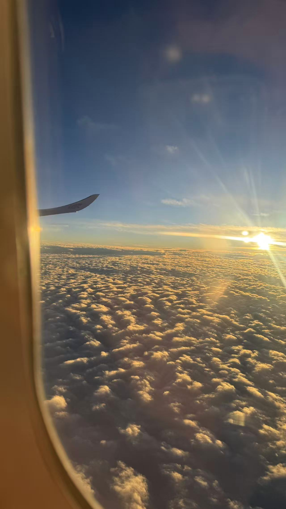
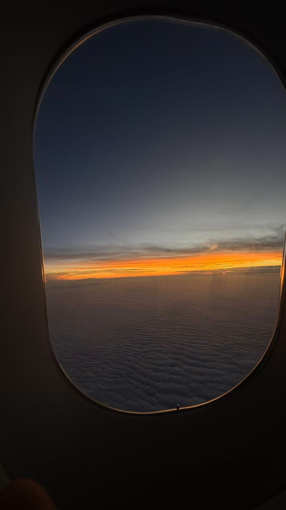
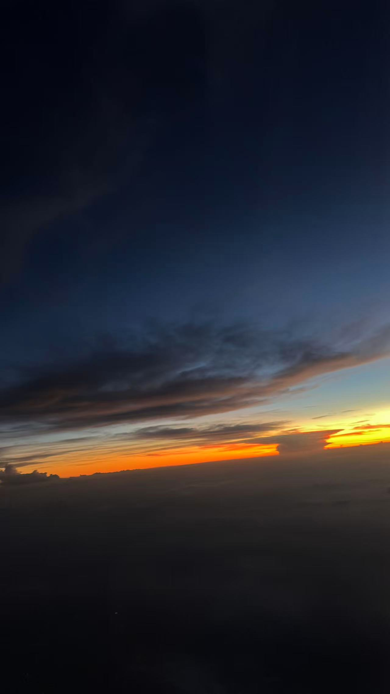

我不知道为什么买了两箱稻香村，只是出发前走到地铁站，入口前有一家稻香村，愣了一会就走进去了。

<!--more-->

--- 

过完安检是一条长长的去登记站台的路，今天人很少，我拎着两箱稻香村就是径直地往前走，心里面好像想开了“不是什么大事，结果怎么样不重要的，大家都彼此冷静冷静”，所以一路上心里面不像前几天那么拧巴。

走到还有两个登机口距离的时候，突然下眼眶就涌出一汪泪来，没等我反应过来，又涌上来一波。有2-3秒反应之后，情绪才跟上来，开始抿着嘴脸转向墙那边，一个劲的朝卫生间走去。把稻香村仍在了地上就赶快摘下眼镜一个劲的洗脸，怎么洗都还是一直往外涌，控制不住它。立马跑到一个卫生间坐在马桶上，不敢发出声，就抿着嘴，但是咽喉里发出奇怪的抽出声，偶尔张开抿着的嘴换口气，整个气氛和声音都难听极了，大约持续了30多秒，停下来了。才开始慢慢整理难过的情绪，原来有些悲伤，确实像之前听过的那样，来不及立马反应。可能是感觉到她好像对我有生理性的排斥和厌恶，以及自己越用力却使情况越来越糟的样子。出来之后，坐到5号登机口，呆呆地只是听歌，什么也不想，坐了一个小时。

登机后睡了1个小时，醒来后看向窗外，在云端之上看到的夕阳是另外一番风景。

望着下落的飞机和暗淡下去的夕阳，回想起来像做了一场大梦一样。

